# Task Continuum Installation Guide

## 1. Create the task repository

Click **New repo** in **EXPLORER**.

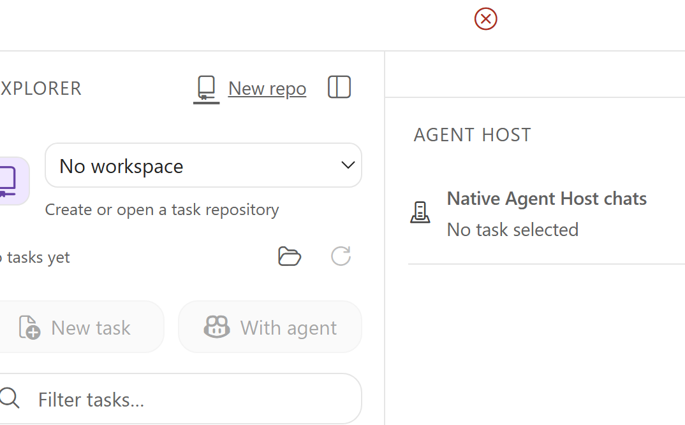

Recommended local repository settings:

- **Parent directory:** `Q:\src\`
- **Repository name:** `task-tc`
- **Full path:** `Q:\src\task-tc`

Click **Create repository**.

This repo stores task files and public SSH connection configuration.
Never commit private keys, passwords, or access tokens.

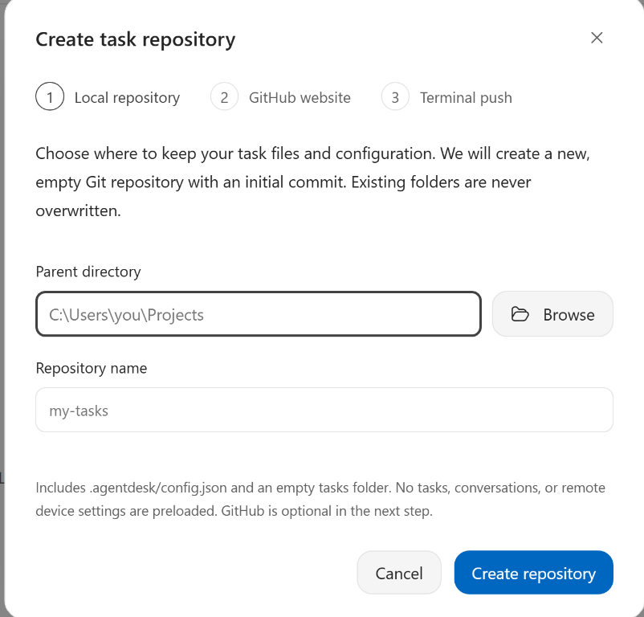

## 2. Create the GitHub repository

Click **Create on GitHub** to open GitHub.

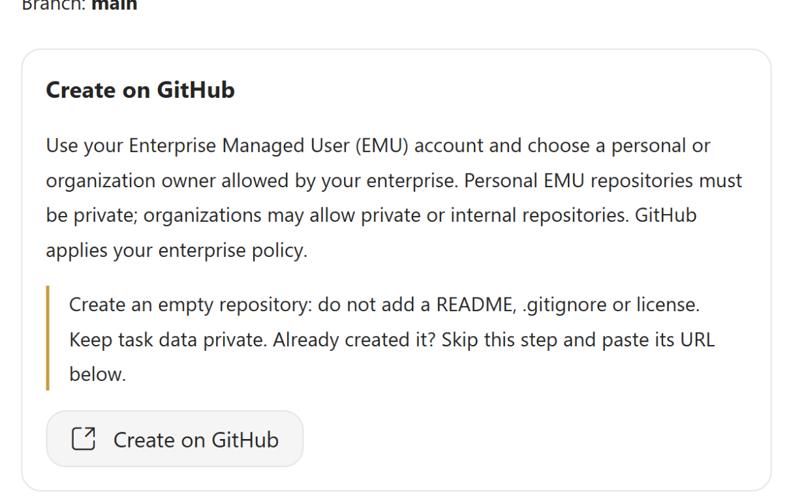

**Sign in with your GitHub EMU account (`ALIAS_microsoft`), not a personal account.**

- **Owner:** your EMU account or an allowed organization
- **Repository name:** `task-tc`
- **Visibility:** **Private**
- **README / .gitignore / license:** do not add

Click **Create repository**.

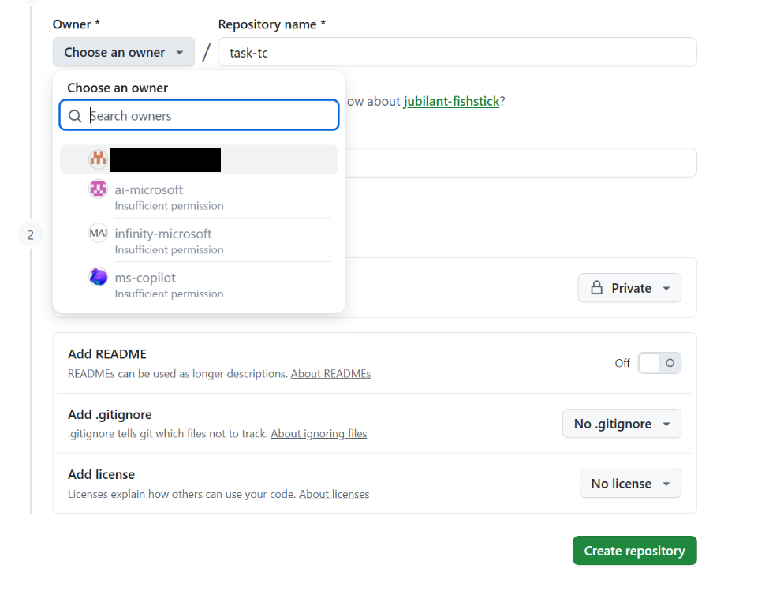

## 3. Paste the repository URL

Back in Task Continuum, paste your repo URL into **GitHub repository URL**.

Example: `https://github.com/ALIAS_microsoft/task-tc`

Replace `ALIAS` with your EMU work alias.

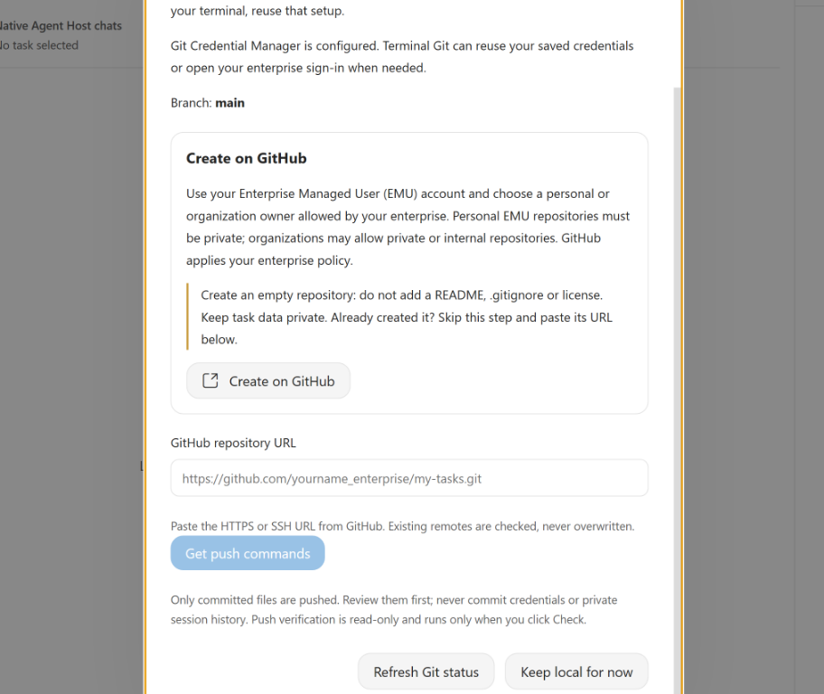

## 4. Push from PowerShell

Click **Get push commands**, then run the generated commands in PowerShell.

```powershell
git -C 'Q:\src\task-tc' remote add -- origin 'https://github.com/ALIAS_microsoft/task-tc'
if ($LASTEXITCODE -eq 0) { git -C 'Q:\src\task-tc' push --no-follow-tags --recurse-submodules=no -u -- origin 'refs/heads/main:refs/heads/main' }
```

## 5. Set up connections

Click **Remote devices** in the activity bar.

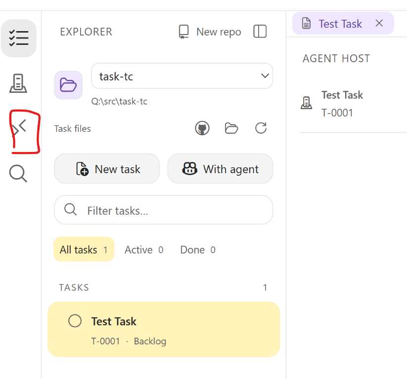

Click **Install Dev Tunnel CLI** and follow
[Microsoft's installation guide](https://learn.microsoft.com/en-us/azure/developer/dev-tunnels/get-started).

Run in PowerShell:

```powershell
winget install Microsoft.devtunnel
```

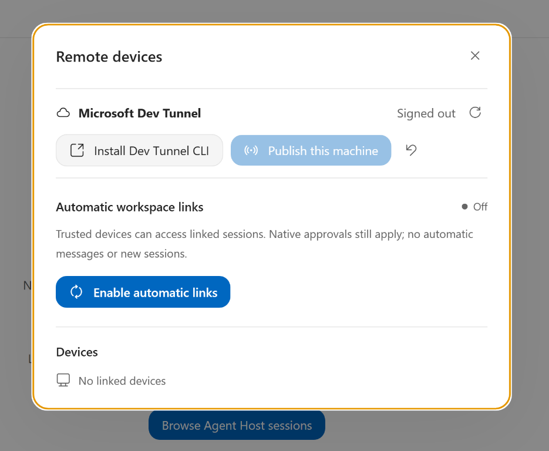

After installation, click **Refresh Dev Tunnel Status** (the refresh icon), then **Sign in with Microsoft**.

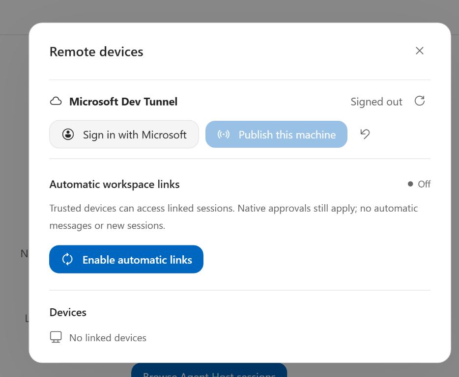

Once signed in, click **Publish this machine**, then **Enable automatic links**.

See [Dev Tunnel setup](remote-vscode.md#managed-dev-tunnel--ssh).

## 6. Link to your session

Open **VS Code Copilot** and create a session. Select **Copilot** mode, not **Local**.

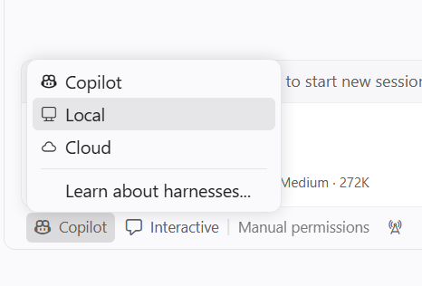

Set **Autopilot** and **Allow all** (trusted workspaces only).

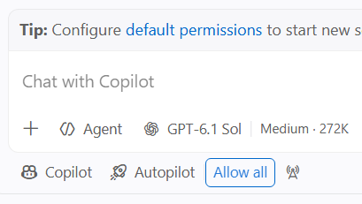

Click **New task** or **Create first task**.

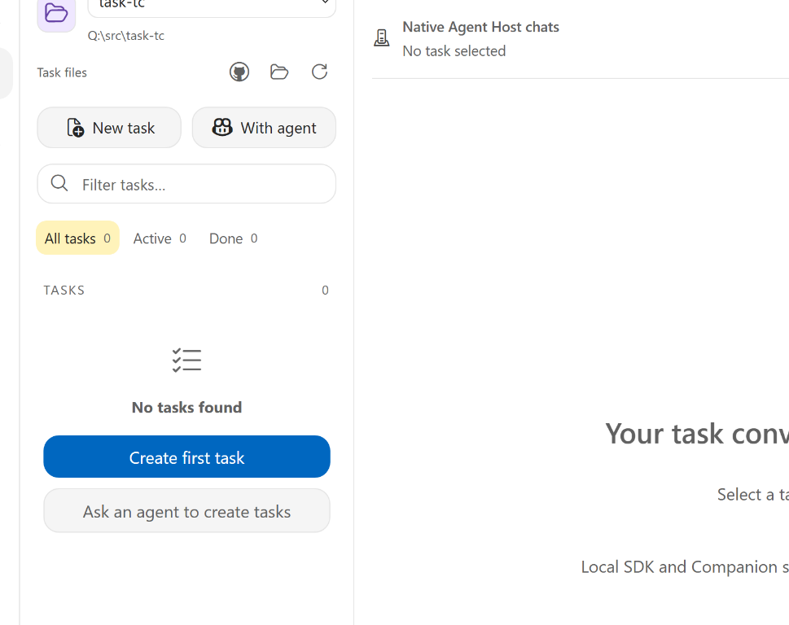

In **Quick create**, enter a **Task title** (e.g. `Test Task`), then click **Create task**.

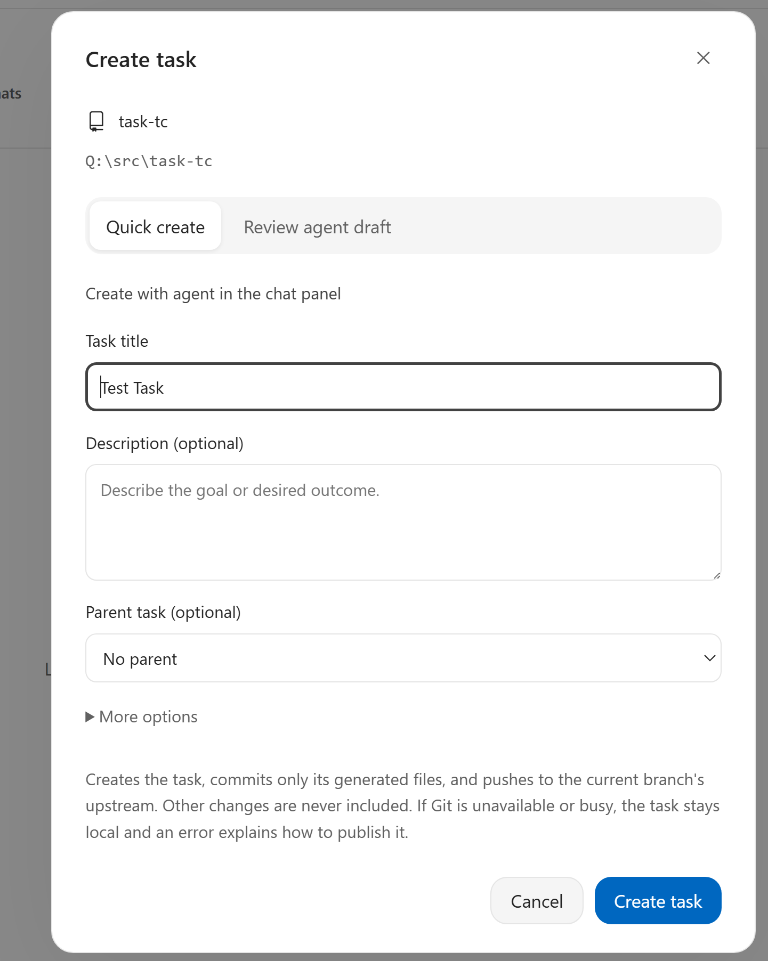

Back in Task Continuum, select your task and open **Agent Host sessions**.

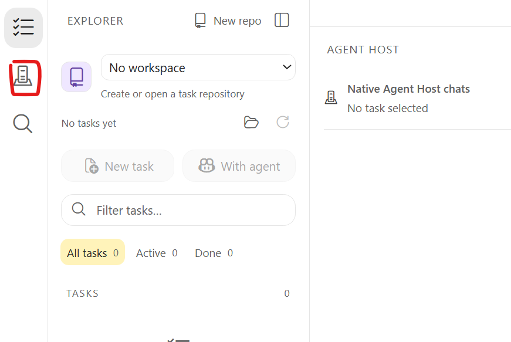

Open **Link**, set **Show** to **Local sessions**, then click **Refresh** to load the latest sessions.

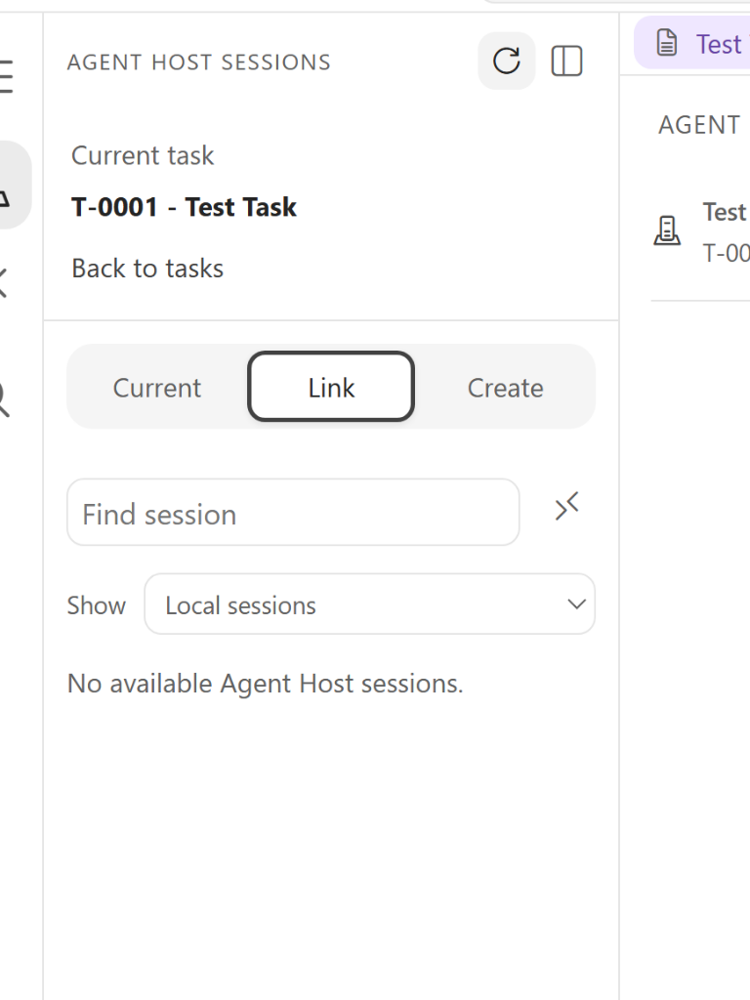

Click the chain icon (`Link <session> to <task>`) beside your session.

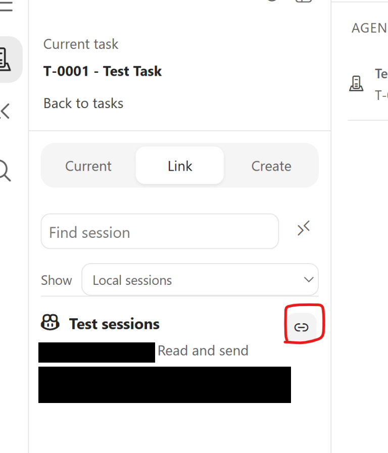

With automatic links enabled for the same workspace, remote machines can see the linked local session.

## 7. Connect your local machine to the Dev Box

Clone the same task repo to `Q:\src\task-tc` if needed. For an existing checkout, pull the latest changes:

```powershell
git -C 'Q:\src\task-tc' pull
```

Open Task Continuum, click the folder icon, and select `Q:\src\task-tc`.

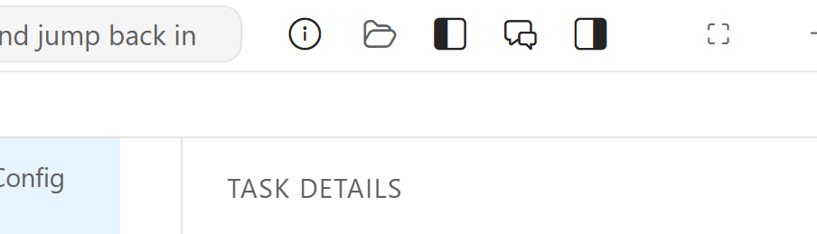

Follow [5. Set up connections](#5-set-up-connections) on this machine using the same Microsoft work account as the Dev Box. Wait for the devices to connect.
